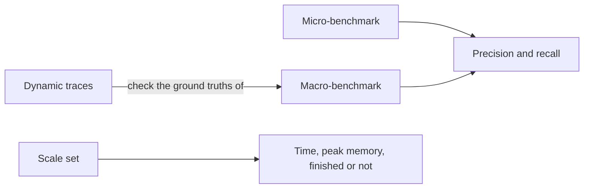
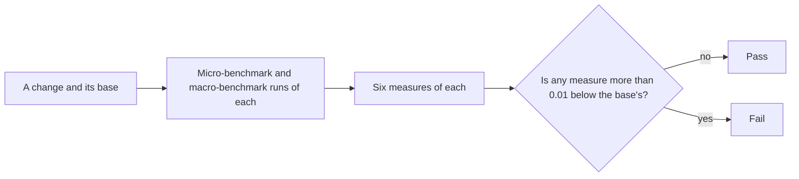

# Evaluation

PyCG claims that its call graphs hold the calls that a program makes, and
few others. The evaluation checks that claim against what Python does when
the code runs.

Every change then shows whether it makes PyCG better or worse, and on which
kind of code.

## The sets

| Set | What it is | Why it exists |
|---|---|---|
| Micro-benchmark | Small programs, one language feature each, grouped by kind of feature, each with the call graph that Python gives when it runs | A case that fails names the feature that PyCG gets wrong, which a large program cannot do. It grew from the benchmark of PyCG's 2021 paper. |
| Macro-benchmark | 60 real packages at pinned releases, each with a hand-written call graph of its source, built site by site from the source and, where the package's tests run, checked against its trace | Real code, where the features mix and most calls cross modules and classes. It shows how well PyCG does on the packages that people analyse, on calls inside the package and into code outside it. |
| Dynamic traces | For each macro-benchmark package whose tests run, the calls that the package made while its own test suite ran: a lower bound of its call graph | A hand-written ground truth can miss a call; a trace records calls that really happen, so every traced call must be in the ground truth. |
| Scale set | 20 large packages, pinned by release or commit, with no ground truth and no score | It shows whether PyCG finishes on large packages, and in how much time and memory under a memory cap. The benchmarks' packages are small enough to analyse in seconds, so they cannot show that. |

The directory of each set has a README with how it was built.
[benchmark-rules.md](benchmark-rules.md) holds the rules by which the
ground truths are written, audited and extended.

## How a change is measured

The six measures are the precision and recall of the three rows of the
results below.

| Measure | Definition |
|---|---|
| Precision | The share of PyCG's edges that are in the ground truth |
| Recall | The share of the ground truth's edges that PyCG finds |
| Inside | Macro-benchmark edges whose callee is in the analysed package |
| Outside | Macro-benchmark edges to builtins, the standard library and other packages, whose names depend on how a tool models code that it does not analyse |

The macro-benchmark's values sum the counts over the 60 packages.

## Results

Measured by CI on main at commit 882960f6:

| Set | Precision | Recall |
|---|---|---|
| Micro-benchmark, all edges | 0.952 | 0.951 |
| Macro-benchmark, inside the package | 0.931 | 0.881 |
| Macro-benchmark, outside the package | 0.945 | 0.821 |

On the scale set, PyCG finishes 19 of the 20 packages, each in under
4 minutes and 8 GiB ([scale/README.md](scale/README.md)).
