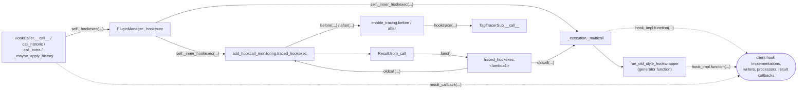

# pluggy 1.7.0: ground-truth notes

Global-rule audit, pass 1 (2026-11-15): 2 removed edges, 0 added
edges; 275 edges after correction. See the
complete audit (audit record `2026-11-15/README.md`).

Pass 2 (2026-11-16): 0 removed edges, 3 added edges; 278 current
edges. Source-site and provenance corrections are recorded in the
pass-2 audit (audit record `2026-11-15/pass-2/README.md`).

The ledger `pluggy.ledger` is the ground truth for pluggy 1.7.0 (commit
`4c7f6365`). The analysed source is `src/pluggy/` (13 modules). Module names
are relative to `src`. The graph `pluggy.json` is generated from the ledger.
`pluggy.rejected.json` holds the five trace edges whose callee is a value
that a client supplied.

The ledger comes from reading the source and from Python semantics. No static
analysis tool was used. The dynamic trace served only as a checklist.

## How a hook call runs

The value sites of pluggy form one chain. This diagram shows the package
callees of each value site. Dashed arrows go to client code, which has no
node.

## Judgement calls

### Code under `if TYPE_CHECKING:`

This code does not run (README default).

| Place | Code | Effect |
|---|---|---|
| `_caller.py:42-44` | `def __getattr__` in `HookRelay` | `HookRelay` has no `__getattr__` at run time. The default rejection of `pluggy._caller.HookRelay.__getattr__` follows from this. The function stays a node with no callers. |
| `_execution.py:40-41` | `cast(Teardown, res)` | Site 41:24 has no callees (note at the site). |
| `_execution.py:136-137` | `cast(Generator[...], res)` | Site 137:40 has no callees (note at the site). |
| `_compat.py:9-10`, `_manager.py:32-33` | `import importlib.metadata` | Imports only, no sites. |

### Branches on the implementation and the version

- `_decorators.py:233-234` chooses `_IMPLICIT_NAMES` by
  `sys.implementation.name`. Both sides run on a supported interpreter. They
  contain no calls.
- `requires-python` is `>=3.10`. No code branches on the Python version.
- `__init__.py` and `_warnings.py` do not import `annotations` from
  `__future__`. Their annotations contain no calls. All other modules import
  it, so their annotations are not sites.

### Objects of the client

The API takes any object in these roles: a plugin (`register`,
`unregister`), a namespace of hook specifications (`add_hookspecs`), a hook
implementation function (found on a plugin, or passed to `call_extra`), the
keyword arguments and results of a hook call, a result callback
(`call_historic`), the arguments of a trace call, a writer (`setwriter`) and
a processor (`setprocessor`). The package passes none of its own objects in
these roles. The ledger treats all such objects as objects of the client
(README, "Client callbacks"). Their methods, also their implicit special
methods, are client code.

The other reading lets the client pass a package object in these roles: a
`HookImpl` as a plugin, a `HookCaller` as a hook argument, a `DistFacade` as
a plugin, a package function marked with `HookimplMarker`. That reading adds
these edges:

- every `{plugin}`, `{plugin!r}`, `str(obj)` and `repr(obj)` site of a client
  object reaches `HookCaller.__repr__`, `_SubsetHookCaller.__repr__` and
  `HookImpl.__repr__`. These sites are in `HookCaller._remove_plugin`,
  `PluginManager.register`, `unregister` and `check_pending`,
  `HookImpl.__repr__`, `TagTracer._format_message` (`{name}`), `_safe_str`
  and `_safe_repr`;
- `PluginManager.register -> DistFacade.__dir__` (`dir(plugin)`, 223:29);
- `PluginManager.get_canonical_name -> DistFacade.__getattr__`
  (`getattr(plugin, "__name__", None)`, 412:35);
- `_multicall` and `run_old_style_hookwrapper` (`hook_impl.function(...)`)
  reach every package callable that a client can mark as a hook
  implementation or pass to `call_extra`. This set has no bound.

The ledger rejects these edges. The reason is at each site. The README
example of a client choice (any stop strategy of tenacity) is a value that
the package defines for that role. pluggy defines no plugin, no hook
implementation, no hook argument and no writer.

### Public and private API

Every function keeps the out-edges of its body, called by the package or
not (rule A). Public and private decide which values reach a site (rule
B1). Public receivers must be constructible and arguments must fit the
roles established by annotations, documentation and supported examples
(B2/B3); arbitrary package objects are not admitted by broad types. Private
functions use the package's actual call inputs, or the public-parameter
fallback when no package call exists. A name is public if a client reaches it
through a path with no component that starts with an underscore, unless it
is marked `:meta private:` (rule C). See "Scope rules" for the full rules.

- `HookCaller` is public (`pluggy.HookCaller`), but its `__init__` is
  `:meta private:`. So the `HookCaller`s are those of the package:
  `_manager.py:247` and `:356`, both with the bound method
  `PluginManager._hookexec`. The four `self._hookexec(...)` sites have this
  one package callee; an `exclude` line records that `_multicall` is not
  one.
- `_SubsetHookCaller` is private. The package makes its instances only in
  `subset_hook_caller` (`_manager.py:648`), each around a `HookCaller` of
  the hook relay, and gives them to the client. It inherits every method
  of `HookCaller` except `__init__` and `__repr__`.
- In the public methods of `HookCaller` (`__call__`, `call_historic`,
  `call_extra`, `get_hookimpls`, `has_spec`, `is_historic`,
  `set_specification`), `self` can be a `_SubsetHookCaller`: the client
  can call them on one. So their loads of `self.spec`, `self._hookimpls`
  and `self._call_history` reach its properties. The same holds in the
  private helpers `_apply_defaults` and `_verify_all_args_are_provided`,
  because the package calls them on the `self` of these public methods.
- The private methods `_remove_plugin`, `_add_hookimpl` and
  `_maybe_apply_history` run on what the package's calls pass
  (`_manager.py:317`, `:255`, `:254`): hook callers taken from the hook
  relay, which the package fills only with `HookCaller` objects
  (`_manager.py:248`, `:357`). Their loads do not reach the properties.
- `PluginManager._verify_hook` is private too. Its calls
  (`_manager.py:239`, `:253`, `:362`) pass hook callers taken from the hook
  relay, so its loads of `hook.spec` do not reach the property either.
- `self._orig` of a `_SubsetHookCaller` is always a `HookCaller` of the
  hook relay, because the private class is instantiated only at
  `_manager.py:648` (rule B1). The loads `self._orig.spec`,
  `self._orig._hookimpls` and `self._orig._call_history` find the slots of
  `HookCaller`.
- `set_specification` on a `_SubsetHookCaller` reads the property `spec`.
  If a specification is present, it raises `ValueError` before constructing
  a new one. If absent, it calls `HookSpec(...)` and then fails because the
  property has no setter. The ledger keeps the calls from both branches.
- Private by the access path: `_multicall` (also through the re-export in
  `pluggy._callers`), `_SubsetHookCaller`, `DistFacade` (`pluggy._compat`),
  `HookSpec` and `varnames` (`pluggy._decorators`, `pluggy._hooks`), and
  `TagTracer` and `TagTracerSub` (`pluggy._tracing`).

### Names of callees outside the package

- `warnings.warn`, `warnings.warn_explicit`: the path that the code imports
  (the trace has `_warnings.warn`).
- Generator methods: `types.GeneratorType.send`, `.throw` and `.close`.
- `slot.__get__` (`_manager.py:90`): `types.MemberDescriptorType.__get__`.
  `static.__get__` of a function (`:111`): `types.FunctionType.__get__`. Of a
  classmethod (`:105`): `<builtin>.classmethod.__get__`.
- Exceptions of the package with no `__init__`: `HookCallError(...)` gives
  `<builtin>.Exception.__init__`, `PluggyTeardownRaisedWarning(msg)` gives
  `<builtin>.UserWarning.__init__`. `super().__init__(message)` in
  `PluginValidationError.__init__` gives `<builtin>.Exception.__init__`.
- `ep.load()` (`_manager.py:521`): `importlib.metadata.EntryPoint.load`.
  `exc.with_traceback(tb)` (`_result.py:103`):
  `<builtin>.BaseException.with_traceback` for annotated client exceptions.
  Package-created `HookCallError`, `RuntimeError`, and
  `PluggyTeardownRaisedWarning` also reach `Result.from_call` through the
  monitored hook call. Their receiver classes add
  `<builtin>.Exception.with_traceback`, `<builtin>.RuntimeError.with_traceback`
  and `<builtin>.UserWarning.with_traceback`. The last path uses a standard
  warnings-as-errors filter on the package-created warning instance.
- `hook.spec.warn_on_impl_args.get(...)` (`_manager.py:458`): no callee.
  The client gives this mapping, annotated with the abstract type
  `Mapping[str, Warning]` (see "Scope rules", B4 and B5).

## Default rejections

| Candidate | Sites decided | Reason |
|---|---|---|
| `pluggy._caller.HookRelay.__getattr__` | 402 | Defined only under `if TYPE_CHECKING:` (`_caller.py:42-44`). It does not exist at run time. |
| `pluggy.__getattr__` | 402 | The module `__getattr__` runs only for an attribute that the module's dict lacks, on the module `pluggy` itself. No package code names that module after `__init__.py:32` defines the function. The relative imports of the submodules (for example `from . import _tracing`, `_manager.py:16`) run earlier, while the package is imported. A receiver that the client supplies (a plugin, a hook function, a namespace of hook specifications) is never that module: it would be an arbitrary package object (rule B3). |
| `pluggy._compat.DistFacade.__getattr__` | 401 | Runs only for an attribute that normal lookup does not find on a `DistFacade` instance. At `_compat.py` 39:29 and 43:32 the receiver is a `DistFacade`, but the attribute is the slot `_dist`, which `__init__` always sets, so normal lookup finds it. At every other site that the default decides, the receiver is not a `DistFacade`: the instances come only from `list_plugin_distinfo` (`_manager.py:539`), which gives them to the client, and a client that passes one as a plugin or a hook function passes an arbitrary package object (rule B3). The ledger accepts the candidate at the one site where normal lookup fails on a `DistFacade`: `self.metadata` (`_compat.py` 34:26). |

The `getattr` sites of the source are 391. The defaults alone decide 340 of
them. The other 51 have a property as a candidate and have an entry.

The defaults also decide the `DistFacade`, `HookRelay` and module
`__getattr__` candidates of 11 explicit `getattr(...)` calls. Their reasons
hold at each one:

| Site | First argument |
|---|---|
| `_compat.py` 39:23 | `self._dist`, an `importlib.metadata.Distribution`: the private `DistFacade` is made only at `_manager.py:539`, from the distributions of `importlib.metadata.distributions()` (`:511`, `:523`). |
| `_decorators.py` 275:27 | `func`, a callable object of the client (a hook implementation or specification): the parameter is `object`, so a package object there is an arbitrary package object (rule B3). |
| `_manager.py` 117:19, 120:19, 122:23 | `holder` and its `__func__`: a function, a `staticmethod` or `classmethod` object, or the function of a bound method (what `_static_hook_attr` returns), never a module, a `HookRelay` or a `DistFacade`. |
| `_manager.py` 236:50, 245:27, 354:48, 488:39, 637:35 | `self.hook`, the `HookRelay` of `PluginManager.__init__` (`Final`), which has no `__getattr__` at run time. |
| `_manager.py` 412:35 | `plugin`, the client's plugin (`object`, rule B3). Also, `__name__` is in the dict of every module, so the module `__getattr__` would not run. |

`getattr(namespace, name)` at `_decorators.py` 345:55 has its own entry that
rejects the three candidates. `namespace` is annotated `_Namespace`
(`ModuleType | type`). Like a bare `Callable`, this admits any module or
class and names no package value for the role of a namespace of hook
specifications. So the module `pluggy` given there is an arbitrary package
object (rules B2 and B3). Through `add_hookspecs`, `name` is also always a
name that `_static_hook_attr` found in the namespace, so normal lookup finds
it. The other reading (any module fits `ModuleType`) adds one edge,
`HookSpec.__init__ -> pluggy.__getattr__`: a client calls
`set_specification(pluggy, opts)` on a hook whose name the module lacks.

## Value sites

| Site | Package callees | Where the value comes from |
|---|---|---|
| `_caller.py:197:30, 222:29, 262:30, 269:37` `self._hookexec(...)` | `PluginManager._hookexec` | `HookCaller.__init__` stores `hook_execute` (`_caller.py:77`). `_SubsetHookCaller.__init__` copies it (`:303`). The package passes `self._hookexec` at `_manager.py:247` and `:356`. Excluded: `_multicall` (no package code passes it, and a client does not build a `HookCaller`, rule C). |
| `_manager.py:183:36` `self._inner_hookexec(...)` | `_multicall`, `traced_hookexec` | Set at `_manager.py:172` (`_multicall`), `:600` (`traced_hookexec`) and `:603` (undo restores an earlier value). |
| `_manager.py:595:32` `oldcall(...)` | `_multicall`, `traced_hookexec` | `self._inner_hookexec` when `add_hookcall_monitoring` ran. A second monitoring wraps the first. |
| `_manager.py:593:19` `before(...)`, `597:18` `after(...)` | `enable_tracing.before`, `enable_tracing.after` | The package passes them at `_manager.py:630`. Other values are client callbacks. |
| `_manager.py:618:22, 627:26` `hooktrace(...)` | `TagTracerSub.__call__` | The `TagTracerSub` that `TagTracer.get` returns at `_manager.py:612`. |
| `_result.py:62:26` `func()` | `traced_hookexec.<lambda1>` | `from_call` is `:meta private:` (rule C), and the package passes only this lambda (`_manager.py:594`). |
| `_result.py:65:19` `cls(...)` | `Result.__init__` | `from_call` is a classmethod, called as `Result.from_call`. |
| `_execution.py:37:33, 39:33, 131:45, 133:45, 147:45, 149:45` `hook_impl.function(...)` | none | Hook implementations of the client (`register`, `call_extra`). |
| `_caller.py:227:32, 273:36` `result_callback(...)` | none | The argument of `call_historic`, a bare `Callable`. No package code passes a package function there (rule B2). |
| `_tracing.py:123:25` `self._writer(...)` | none | `None`, or the argument of `setwriter`, a bare `Callable`. No package code passes a package function there (rule B2). |
| `_tracing.py:125:22` `processor(...)` | none | The argument of `setprocessor`, a bare `Callable`. No package code passes a package function there (rule B2). |
| `_tracing.py:147:30` `self.__class__(...)` | `TagTracerSub.__init__` | `self.__class__` is `TagTracerSub`, a private class (rule B1). |

The `next`, `send`, `throw` and `close` calls of `_multicall` on a teardown
(`_execution.py` 126:21, 167:39, 175:43, 180:34) have an `exclude`
line for `run_old_style_hookwrapper`: its body resumes there, but by the
generator rule its edge comes from 122:57. Its single yield means that
resuming it finishes or raises before 184:31; that later `close` has only
an opaque client wrapper result and no named callee.

## The wrapper protocol

- `run_old_style_hookwrapper` is the only generator function of the package.
  By the generator rule, its edge comes from `_multicall`, which calls it
  (`_execution.py:122`). Its body runs at `next(function_gen)` (`:126`) and
  at the `send`, `throw` and `close` of the teardown loop. The calls of the
  body are edges of `run_old_style_hookwrapper`: `Result.__init__`,
  `Result.get_result`, `_raise_wrapfail`, `_warn_teardown_exception`,
  `<builtin>.next`. Its `teardown` is a client callback result; B5 excludes
  concrete method edges for its `send` and `close` calls.
- New-style wrappers and old-style hookwrappers are generator functions of
  the client. `_multicall` drives them with `next`, `send`, `throw` and
  `close`. Their callback results are opaque under B5. `<builtin>.next` remains an
  explicit call. The `types.GeneratorType.*` edges of `_multicall` instead
  have a package-created receiver: `run_old_style_hookwrapper` itself.
- The `Result` that an old-style hookwrapper receives is used by client code
  (`get_result`, `force_result`, `force_exception`, `excinfo`). Those calls
  have no package caller.

## Functions that no site calls

| Function | Why |
|---|---|
| `pluggy.__getattr__` | Module `__getattr__`. Only the client reaches it (`pluggy.__version__`). |
| `pluggy._caller.HookRelay.__getattr__` | Under `if TYPE_CHECKING:`. Never defined at run time. |
| `HookCaller.__call__`, `call_historic`, `call_extra` | Public API: the client calls the hooks. The package calls no hook. |
| `HookCaller.__repr__`, `_SubsetHookCaller.__repr__`, `HookImpl.__repr__` | Special methods. No package site formats these objects (see "Objects of the client"). |
| `DistFacade.__dir__`, `DistFacade.project_name` | Used by the client on the objects of `list_plugin_distinfo`. |
| `HookspecMarker.__init__`, `.__call__`, `HookimplMarker.__init__`, `.__call__` | Public API (decorators of the client). |
| `PluginManager.__init__`, `add_hookspecs`, `check_pending`, `enable_tracing`, `get_plugins`, `is_registered`, `list_name_plugin`, `list_plugin_distinfo`, `list_plugin_distributions`, `load_setuptools_entrypoints`, `set_blocked`, `subset_hook_caller`, `unblock` | Public API. |
| `add_hookcall_monitoring.undo` | Returned to the client. |
| `Result.force_exception`, `force_result` | Public API of a `Result` for old-style hookwrappers of the client. |
| `Result.excinfo` | Marked private and never called by the package; its body keeps its `type` edge under rule A and the uncalled-private fallback. |
| `TagTracer.setprocessor`, `setwriter`, `TagTracerSub.get` | Public API of the tracer (`pm.trace`). |

Every other function has a caller in the graph. There is no dead code:
`HookRelay.__getattr__` exists only for type checkers.

## Trace reconciliation

The trace has 272 edges; 100 of 101 functions run (not
`HookRelay.__getattr__`).

- 267 raw trace edges confirm 269 graph edges through aliases.
- 5 are excluded by B5 and are in
  `pluggy.rejected.json`:
  `HookCaller._maybe_apply_history -> <builtin>.list.append`
  (`result_callback`, the tests pass `result.append`),
  `TagTracer._processmessage -> <builtin>.list.append` (`self._writer`, the
  tests pass `out.append`) and
  `PluginManager._verify_hook -> <builtin>.dict.get`
  (`warn_on_impl_args.get`, the tests pass a dict where the annotation is
  the abstract `Mapping`; see "Scope rules", B4). The other two are
  `run_old_style_hookwrapper` to `types.GeneratorType.send` and `.close`,
  methods on an opaque client callback result.

9 edges of the graph come only from reading:

| Edge | Why the tests do not make it |
|---|---|
| `HookCaller.call_extra -> _SubsetHookCaller._hookimpls`, `-> _SubsetHookCaller.spec` | No test calls `call_extra` on a subset hook caller. |
| `HookCaller.get_hookimpls -> _SubsetHookCaller._hookimpls` | No test calls `get_hookimpls` on a subset hook caller. |
| `HookCaller.has_spec -> _SubsetHookCaller.spec` | No test calls `has_spec` on a subset hook caller. |
| `HookCaller.set_specification -> _SubsetHookCaller.spec` | No test calls `set_specification` on a subset hook caller. |
| `traced_hookexec.<lambda1> -> traced_hookexec` | No test adds a monitoring on top of another one. |
| `load_setuptools_entrypoints -> importlib.metadata.distributions`, `-> importlib.metadata.EntryPoint.load` | The tests replace `importlib.metadata.distributions` with a function that returns fake distributions (`testing/test_pluginmanager.py:907-935`). |
| `Result.get_result -> <builtin>.RuntimeError.with_traceback` | A monitored hook call can carry the package-created zero-yield wrapper error through `Result.from_call`. The other two added exception receiver names match aliases in the existing trace. |

## Statistics

| Item | Count |
|---|---|
| All AST sites in the source | 1,131: the 795 sites below plus 336 implicit sites without package candidates |
| Explicit or candidate-bearing sites | 795: 320 `call`, 18 `decorator`, 391 `getattr`, 66 `format` |
| Ledger entries | 455: 320 `call`, 18 `decorator`, 66 `format`, 51 `getattr` |
| Callee lines (`->`) | 351 |
| Rejection lines (`reject`) | 132 |
| Exclusion lines (`exclude`) | 8 |
| Notes | 83 |
| Value sites | 23 |
| Default rejections | 3 (402, 402 and 401 sites; 11 of them explicit `getattr` calls) |
| Nodes | 114 (13 modules, 101 functions and lambdas) |
| Edges | 278: 112 in the package, 166 to 77 callees outside |
| Edges that the trace confirms | 269 of 278 (96.8%) |
| Trace edges in `pluggy.rejected.json` | 5 |
| Edges only from reading | 9 (6 in the package, 3 outside) |

## Scope rules

These rules hold for all 30 projects of the macro-benchmark. The
authoritative text is "Scope rules" in `macro-benchmark/README.md`; this
section restates each rule in short and shows how this ledger applies it.

**A. Edges are per function.** The edges of a function are the calls that
its body can make when it runs. Rule A is about whether a function runs: a
function keeps the edges of its body even if nothing calls it. Which values
its body sees is rule B. Global rule A permits rejection of client-supplied
callees, implicit outside calls, direct private-API test inputs excluded by
B1/B2 and C, and trace naming artifacts. An uncalled private body still
uses the public-parameter fallback; this is not an entry-point reachability
restriction.

- Functions that no package site calls keep their edges: the public API
  (`HookCaller.__call__`, `PluginManager.subset_hook_caller`, ...) and the
  special methods that only clients reach (`DistFacade.project_name ->
  DistFacade.__getattr__`). See "Functions that no site calls".
- `pluggy.rejected.json` has five edges with client-supplied callees:
  `list.append` as the result callback of `call_historic` and as the writer
  of `setwriter`, the `get` of the dict passed as `warn_on_impl_args`
  (see B4), and `send` and `close` on the opaque old-style callback result
  in `run_old_style_hookwrapper` (B5).

**B. Edges are limited by the values that can reach a call site.**

- **B1. Receivers and the values of private functions.** Only instances
  that the package or a client can create count. A client creates
  instances of public classes; a private class is instantiated only where
  the package does it. In a public method, `self` can be any such instance
  of the class, or of a package subclass that inherits the method (or
  calls it explicitly on itself), because a client can call the method on
  it. In a private method, or any function that clients do not call,
  `self` and the arguments are the objects that the package's calls of it
  pass. If the package never calls a private function, its parameters are
  treated as for a public one, so its body keeps its edges (rule A). An
  abstract class, Protocol, or class whose initializer always raises has no
  completed instance. Failed argument binding adds no call edge; an entered
  body that then raises keeps calls it makes. A failed object is not reused
  and clients do not reinitialize instances. pluggy has no abstract or
  always-failing class constructor.
  - `_SubsetHookCaller` instances come only from `subset_hook_caller`
    (`_manager.py:648`), which gives them to the client.
    `_SubsetHookCaller` inherits every method of `HookCaller` except
    `__init__` and `__repr__`. In the public methods (`__call__`,
    `call_historic`, `call_extra`, `get_hookimpls`, `has_spec`,
    `is_historic`, `set_specification`), the client can call the method on
    a `_SubsetHookCaller`, so the loads of `self.spec`, `self._hookimpls`
    and `self._call_history` reach its properties. The private helpers
    `_apply_defaults` and `_verify_all_args_are_provided` get the `self` of
    these public methods, so their loads reach the properties too.
  - The private methods `_remove_plugin`, `_add_hookimpl` and
    `_maybe_apply_history`, and the parameter `hook` of the private
    `PluginManager._verify_hook`, get what the package's calls pass
    (`_manager.py:317`, `:255`, `:254`; `:239`, `:253`, `:362`): hook
    callers taken from the hook relay, which the package fills only with
    `HookCaller` objects (`_manager.py:248`, `:357`). There the properties
    are rejected.
  - The properties are rejected at `self._orig.*`: every
    `_SubsetHookCaller` that exists wraps a `HookCaller` of the hook relay
    (`_manager.py:637`, `:648`). They are rejected at `orig._hookimpls` in
    `subset_hook_caller` too, because the relay holds only `HookCaller`s.
  - `DistFacade` instances come only from `list_plugin_distinfo`
    (`_manager.py:539`). This gives the default rejection of
    `DistFacade.__getattr__`, accepted only at `self.metadata`.
  - `TagTracer` and `TagTracerSub` are in the private module `_tracing`.
    The client reaches them only through `pm.trace`, which
    `PluginManager.__init__` makes, and through the `TagTracerSub` objects
    that `get` makes from it. So `TagTracerSub.root` is always a
    `TagTracer`, and `self.trace.root.get(...)` calls `TagTracer.get`.
- **B2. Arguments.** An argument is an object of the client, or a value
  that the package defines for the role of that parameter, or a default of
  the package. A value from outside the package that the client passes is
  a client callback, also when the documentation shows it as an example
  (`setwriter(print)`). Annotations, including shipped stubs, take precedence
  over conflicting documentation; `Any` supplies no type information. Bare
  `object`, `type`, `ModuleType` and `Callable` do not name package choices.
  Public attribute assignment needs a source, documentation or test witness
  for that use; it does not admit arbitrary mutation of package state.
  - `before` and `after` of `add_hookcall_monitoring`: the package passes
    `enable_tracing.before` and `.after` (`_manager.py:630`). These are the
    callees of `traced_hookexec`.
  - `hook_execute` of `HookCaller`: the package passes the bound method
    `PluginManager._hookexec` (`_manager.py:247`, `:356`). This is the
    callee of the four `self._hookexec(...)` sites. The annotation
    `_HookExec` is a bare `Callable`, so it is no evidence for
    `_multicall` (an `exclude` line at each site).
  - `namespace` of `HookSpec.__init__` (and `module_or_class`,
    `specmodule_or_class` before it) is annotated `ModuleType | type`. Like
    a bare `Callable`, this admits any module or class and names no
    package value for the role, so the module `pluggy` is not a namespace
    (B3). See "Default rejections" for the one edge that the other reading
    adds.
  - Hook implementation functions, result callbacks, writers and
    processors: the package defines no value for these roles and passes
    none. These sites have no package callee, and a note says so.
- **B3. Arbitrary package objects.** A package object that a client passes
  where the API accepts any object is not considered: a `HookImpl` or a
  `DistFacade` registered as a plugin, a `HookCaller` as a hook argument, a
  `DistFacade` given to `copy` or `pickle`. So the ledger rejects the three
  `__repr__` methods at every format, `str()` and `repr()` site of a client
  object, `DistFacade.__dir__` at `dir(plugin)` (`_manager.py` 223:29), and
  `DistFacade.__getattr__` at `getattr(plugin, "__name__", None)` (412:35).
  The module `pluggy` given as a plugin or as a namespace of hook
  specifications is such an object too, so the default rejection of
  `pluggy.__getattr__` holds at every `getattr(...)` site, also at
  `_decorators.py` 345:55. See "Objects of the client".
- **B4. Concrete outside types.** A method call on a value is an edge to
  the method of its type only when that type is concrete: the package
  builds the value, or the annotation or the documentation fixes a
  concrete class from outside the package (`dict`, `list`, `str`,
  `logging.Logger`). Shipped stubs count as annotations. When annotations
  and documentation differ, annotations decide; `Any` supplies no type, so
  documentation can still fix a concrete outside class. An abstract type
  (`Mapping`, `Sequence`, `Iterable`, `Callable`, a protocol) does not fix
  the class. An abstract `isinstance` check does not override a concrete
  class documented for that function; this differs from an abstract
  parameter annotation taking precedence over conflicting documentation.
  A test-supplied concrete object does not override an abstract annotation.
  Client callbacks and their results remain opaque under B5.
  - Values that the package builds keep the edges of their type:
    `_name2plugin`, `_tags2proc`, `hook.__dict__`, the lists, the set of
    `subset_hook_caller` and the str literals.
  - Values of the client with a concrete type keep them too:
    - The `HookspecOpts` and `HookimplOpts` options: a `TypedDict`
      annotation, and a `TypedDict` value is a plain `dict` at run time;
      `_get_marker_opts` also admits only dicts (`isinstance`,
      `_manager.py:119`, `:124`). So `<builtin>.dict.get` at `_caller.py`
      109:25, 195:41, 261:41, `_decorators.py` 355:37, 356:42, `_manager.py`
      235:46, and `<builtin>.dict.setdefault` in `normalize_hookimpl_opts`.
    - Values that the package checks with `isinstance`: the trailing dict
      of a trace call (`_tracing.py` 108:39), the str `tags` (132:36) and
      `obj` (67:30), the dict of `_instance_dict` (`_manager.py` 84:40), the
      descriptors of `_static_hook_attr` (90:41, 105:66, 111:38).
    - Values annotated with a concrete class: the str values `qualname`,
      `text` and `rendered` (`_decorators.py` 310:28, `_tracing.py` 34:20,
      36:23, 53:43, 112:39), the `BaseException` of `Result.get_result`
      (`_result.py` 103:37).
    - The generators of hook wrappers: the documentation requires a
      function with exactly one `yield`, which gives a generator when it is
      called, and `_verify_hook` rejects other functions
      (`inspect.isgeneratorfunction`, `_manager.py:464`). This contract
      does not override B5: their callback results remain opaque. Concrete
      generator-method edges require the package-created
      `run_old_style_hookwrapper` generator in `_multicall`.
  - `ep.load()` (`_manager.py` 521:33) is a call on an `EntryPoint` that
    `importlib.metadata` gives the package, not a value of the client.
  - `hook.spec.warn_on_impl_args.get(...)` (`_manager.py` 458:66) is a call
    on the client's object of the abstract type `Mapping[str, Warning]`
    (`_decorators.py:69`), which the package passes on without a copy or a
    check. The site has no callee. The trace edge
    `_verify_hook -> <builtin>.dict.get` (the tests pass a dict) is in
    `pluggy.rejected.json`.
  - No other site calls a method on a client value of an abstract type.
    The `Mapping` arguments `kwargs` of `call_historic` and `call_extra`,
    and `caller_kwargs` of `_multicall`, are only subscripted, tested with
    `in` and unpacked with `**`. The `Sequence` and `Iterable` arguments
    (`methods`, `remove_plugins`, `hook_impls`) are only iterated or given
    to `set()` and `reversed()`. The `Callable` arguments are the value
    sites of B2.
- **B5. Client objects are opaque.** A client object whose class no
  concrete type fixes is opaque. The ledger does not follow what it does:
  its methods, also its implicit special methods (`__eq__`, `__hash__`,
  `__str__`, the `keys` of a `**` unpacking), are client code and give no
  edges.

**C. "Public" is judged on the public access path.** A class or function is
public if a client can reach it through a path with no component that
starts with an underscore (`pluggy.PluginManager`, although
`pluggy._manager` defines it). It is not public if it is marked private.

- Public: `PluginManager`, `HookspecMarker`, `HookimplMarker`,
  `HookCaller`, `HookImpl`, `HookRelay` and `Result`, through `pluggy`.
- Marked private: `HookCaller.__init__`, `HookImpl.__init__`,
  `HookRelay.__init__`, `Result.__init__`, `Result.from_call`,
  `Result.excinfo` and `Result.exception` (`:meta private:`). So the
  `HookCaller`s are the ones that the package
  creates (`_manager.py:247`, `:356`), with the executor
  `PluginManager._hookexec`. A client that builds
  `HookCaller(name, _multicall)` is not considered; that reading would add
  the four edges `HookCaller.__call__`, `call_historic`, `call_extra` and
  `_maybe_apply_history -> pluggy._execution._multicall`.
- Private: `_multicall` (also through the re-export in `pluggy._callers`),
  `_SubsetHookCaller`, `DistFacade` (`pluggy._compat`), and the classes of
  `pluggy._tracing`.

## Same-function placement clarification (2026-11-16)

The M7 move of TagTracer._format_message -> _safe_str from _tracing.py:103:31
to103:27 is an allowed map placement normalization under README ruling 12.
The previous constructor attribution was valid because join consumes that
map in the same function. The chosen consumer relation remains; no graph
pair changes. The original seven metadata groups comprise six baseline
correction groups and this one normalization.
