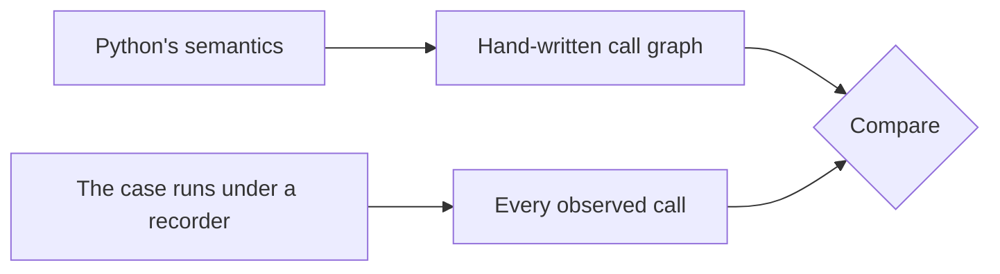

# Micro-benchmark

696 small Python programs in 34 categories, each testing one language
feature (arguments, classes, decorators, `match`, `async` and others).

A case that a tool gets wrong names the feature it gets wrong, which a large
program cannot do.

## The ground truth

| | |
|---|---|
| Content | The call graph of the calls that Python makes when the case runs |
| Nodes | Modules, functions and lambdas |
| Callees outside the program | Builtins, the standard library, modules that do not exist and behave as stubs |
| Written | By hand from Python's semantics, never from a tool's output |
| Checked | By running the case under a recorder that observes every call and compares it with the hand-written graph |

## Scoring

A tool's graph is scored by edge precision and recall, counted over the
edges of all cases.

## Limits

| Limit | Consequence |
|---|---|
| The recorder cannot observe some calls (a generator function that the interpreter calls, implicit calls at an unrelated point such as `__del__`) | A case that depends on them is checked by hand |
| The recorder accepts any name that resolves to the callee | Whether a ground truth uses the canonical name is a review check |
| A module that does not exist is replaced by a stub | The stub cannot model every use of a real module |

The full conventions, the validation and its limits, and how to add a case
are in [benchmark-rules.md](../benchmark-rules.md#micro-benchmark).
